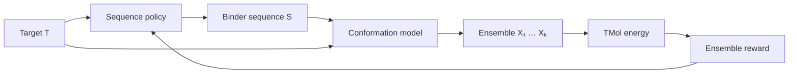

<p align="center">
  
</p>

<p align="center">
  <em>Ensemble-aware protein binder design with generative conformational models and differentiable molecular energetics.</em>
</p>

<p align="center">
  
  
  
</p>

## Overview

CINDER is a research framework for testing one hypothesis: that ranking and optimising binder
sequences using an **ensemble** of conformations, scored by a differentiable energy (TMol),
tracks binding better than scoring a single minimised structure. It does not claim novelty,
and it makes no claim of experimentally validated affinity optimisation.



The physics (energy), the generative model (conformations), the sequence optimiser and the
experiment machinery are separate components joined by typed interfaces, so diffusion, flow
matching, normalising flows, Langevin sampling or BioEmu2 can be swapped without touching the
sequence-training code.

## Why ensembles?

A single minimised structure reports one point of a distribution. Sequences can look excellent
at that point yet be brittle to small conformational changes, or the reverse. Averaging (or
soft-minimising) the design energy over $p(X\mid S,T)$ rewards sequences that are good across
the accessible conformations.

## Mathematical formulation

$$
p_{\mathrm{guided}}(X\mid S,T)\;\propto\;p_{\mathrm{base}}(X\mid S,T)\,e^{-\lambda\,U_{\mathrm{TMol}}(X,S,T)}
$$

$$
S\sim q_\phi(S\mid T),\qquad X_k\sim p_{\mathrm{guided}}(X\mid S,T),\qquad
R(S)=-\frac1K\sum_{k=1}^K U_{\mathrm{design}}(X_k,S,T)
$$

In words: a sequence policy proposes binders; for each, a conformational model draws $K$
structures, tilted toward low energy by a guidance strength $\lambda$; the energy of each
structure is computed deterministically; the average is the sequence's reward, used to update
the policy by policy gradient. $\lambda$ is a tunable coefficient, **not** a calibrated
temperature, and $U_{\mathrm{design}}$ is a surrogate, not $\Delta G_{\mathrm{bind}}$.

<details><summary>Further equations</summary>

Guided score: $\nabla_X\log p_{\mathrm{guided}}=\nabla_X\log p_{\mathrm{base}}-\lambda\nabla_XU$.
Langevin step: $X'=X-\eta\lambda\nabla U+\sqrt{2\eta}\,\epsilon$.
Flow objective: $L=\mathbb E_q[\lambda U+\log q]\ge-\log Z$.
Policy loss: $-(R-b)\log q_\phi(S)-\alpha H[q_\phi]$. See [docs/theory.md](docs/theory.md).

</details>

## Model families

| Conformational model | Status |
|---|---|
| Langevin (energy-only / score-guided) | implemented, tested against closed forms |
| Conditional normalising flow (toy coordinates) | implemented, tested against $-\log Z$ |
| Diffusion, flow matching, BioEmu2 adapter | interfaces + experimental stubs |

## Quick start

```bash
conda activate cinder
pip install -e ".[dev]"        # add ",tmol" for the TMol backend
cinder doctor
cinder design --config configs/experiment/toy_design.yaml   # CPU toy S→X→U→R→S loop
pytest                                                      # CPU tests
pytest -m tmol                                              # needs TMol
cinder score  --config configs/experiment/score.yaml        # barnase/barstar, needs TMol
```

## Repository structure

```
src/cinder/  types.py  config.py  cli.py  doctor.py
  systems/ energy/ conformations/ sequence/ objectives/ optimization/ experiments/ utils/
configs/  docs/  examples/  tests/  assets/
```

## Current status / roadmap

- [x] Foundation, config, CLI, CI, docs
- [x] Analytic toys, Langevin, energy guidance
- [x] TMol evaluator: scoring, gradients (finite-difference checked), interface decomposition, batching
- [x] Local restrained ensembles around a crystal pose
- [x] Categorical policy + REINFORCE converging to a brute-force optimum (toy)
- [x] Toy normalising flow
- [ ] **TMol-driven sequence design on a real complex** — blocked on variable atom count; the
      adapter currently evaluates the native sequence only ([docs/tmol.md](docs/tmol.md))
- [ ] Protein-scale learned conformational models; diffusion / flow matching; BioEmu2 prior
- [ ] Benchmarks: single structure vs ensemble; guided vs unguided; vs random / MPNN proposals

## Documentation

[Theory](docs/theory.md) · [Architecture](docs/architecture.md) · [TMol](docs/tmol.md) ·
[Models](docs/models.md) · [Sequence optimisation](docs/sequence_optimization.md) ·
[Development](docs/development.md)

## Citation

See [CITATION.cff](CITATION.cff). The test complex is barnase/barstar from PDB 1BRS
(Buckle, Schreiber & Fersht, 1994).

## License

Apache-2.0.
