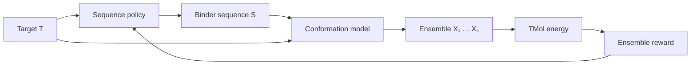

<p align="center">
  
</p>

<p align="center">
  <em>Ensemble-aware protein binder design with generative conformational models and differentiable molecular energetics.</em>
</p>

<p align="center">
  
  
  
</p>

## Overview

CINDER is a research framework for testing one hypothesis: that ranking and optimising binder
sequences using an **ensemble** of conformations, scored by a differentiable energy (TMol),
tracks binding better than scoring a single minimised structure.

**Novelty, stated carefully.** Each ingredient, and several pairings of them, are established
(see [Related work](#related-work)): ensemble-averaged design with a Rosetta-family energy
(RosettaBackrub, multistate design), energy-based preference optimisation for complexes
(EnerBridge-DPO), reinforcement learning for binders (ProtRL), and Boltzmann-style ensemble
objectives for training conformation generators. In a limited literature search I did not find a
single framework combining all of: a **policy-gradient sequence optimiser**, a **swappable
conformational model**, **energy guidance from a differentiable all-atom energy**, and an
**ensemble-level reward**, applied to **folded protein binders**. Treat the combination as a
recombination of known parts, not a demonstrated novelty. CINDER makes no claim of experimentally
validated affinity optimisation.

**Current status in one paragraph.** The machinery works on analytic toy problems, the TMol
evaluator and its gradients are verified on real complexes, binder structure recovery is validated
on three helical complexes in Cartesian, rigid-body and torsion spaces, mutated sequences are
built and scored (single packed structure or jump-space ensemble), and `cinder design` runs a
sequence-optimisation loop on a real complex with TMol. **Not yet done:** any comparison with
experimental binding data, so the central ensemble-versus-single-structure hypothesis is
untested. See [TODO.md](TODO.md).



The physics (energy), the generative model (conformations), the sequence optimiser and the
experiment machinery are separate components joined by typed interfaces, so diffusion, flow
matching, normalising flows, Langevin sampling or BioEmu2 can be swapped without touching the
sequence-training code.

## Why ensembles?

A single minimised structure reports one point of a distribution. Sequences can look excellent
at that point yet be brittle to small conformational changes, or the reverse. Averaging (or
soft-minimising) the design energy over $p(X\mid S,T)$ rewards sequences that are good across
the accessible conformations.

*Status:* ensemble averaging is implemented for both the toy problem and TMol (K jump-space poses
per packed mutant, aggregated into a reward), and the recovery benchmarks use single trajectories.
The claim that ensembles rank binders better than a single structure has not been tested against
experimental data.

## Mathematical formulation

$$
p_{\mathrm{guided}}(X\mid S,T)\;\propto\;p_{\mathrm{base}}(X\mid S,T)\,e^{-\lambda\,U_{\mathrm{TMol}}(X,S,T)}
$$

$$
S\sim q_\phi(S\mid T),\qquad X_k\sim p_{\mathrm{guided}}(X\mid S,T),\qquad
R(S)=-\frac1K\sum_{k=1}^K U_{\mathrm{design}}(X_k,S,T)
$$

In words: a sequence policy proposes binders; for each, a conformational model draws $K$
structures, tilted toward low energy by a guidance strength $\lambda$; the energy of each
structure is computed deterministically; the average is the sequence's reward, used to update
the policy by policy gradient. $\lambda$ is a tunable coefficient, **not** a calibrated
temperature, and $U_{\mathrm{design}}$ is a surrogate, not $\Delta G_{\mathrm{bind}}$.

<details><summary>Further equations</summary>

Guided score: $\nabla_X\log p_{\mathrm{guided}}=\nabla_X\log p_{\mathrm{base}}-\lambda\nabla_XU$.
Langevin step: $X'=X-\eta\lambda\nabla U+\sqrt{2\eta}\,\epsilon$.
Flow objective: $L=\mathbb E_q[\lambda U+\log q]\ge-\log Z$.
Policy loss: $-(R-b)\log q_\phi(S)-\alpha H[q_\phi]$. See [docs/theory.md](docs/theory.md).

Rigid-body (jump) moves of the binder use six numbers $q=(t,\,r)$: a translation $t$ and a rotation
vector, giving $x'=R(\omega)(x-c)+c+t$ about the binder centroid $c$ (rotation scaled to
Å-equivalents by the binder's radius of gyration). The map is differentiable, so
$\partial U/\partial q$ follows from the chain rule through TMol's coordinate gradients, and the
binder's internal geometry is preserved exactly.

</details>

## Model families

| Conformational model | Status |
|---|---|
| Langevin (energy-only / score-guided), Cartesian | implemented, tested against closed forms |
| Langevin in rigid-body (jump) space | implemented, validated on three complexes |
| Langevin in torsion space (phi/psi, or chi) | implemented; needs the binder `internal` energy |
| Torsion + rigid-body jumps combined | implemented |
| Conditional normalising flow (toy coordinates) | implemented, tested against $-\log Z$ |
| Diffusion, flow matching, BioEmu2 adapter | interfaces + experimental stubs |

## Validation

What has been verified, and what has not. Numbers come from `python scripts/validation_report.py`
(seeded, CPU, about a minute; the TMol rows need TMol installed).

**Verified on analytic toy problems with known answers.** These test the machinery (samplers,
guidance, flow objective, policy gradient), not protein biology.

| Check | Measured | Expected |
|---|---|---|
| Langevin, harmonic: variance | 0.1670 | 0.1667 |
| Guided product of Gaussians: mean | 1.4914 | 1.5000 |
| Guided product of Gaussians: variance | 0.2686 | 0.2500 |
| Double well: fraction in right well | 0.508 | 0.500 |
| Flow, Gaussian: final loss vs bound −log Z | −1.1391 | −1.1447 (bound) |
| Flow, bimodal: final loss vs −log Z | 0.0751 | 0 (bound) |
| Flow, bimodal: fraction in right mode | 0.505 | 0.500 |
| Policy: consensus sequence | IR | IR (brute force over 400) |
| Policy: mean reward, last 10 iterations | 2.195 | 2.214 (analytic optimum) |
| Policy: entropy first → last iteration | 5.99 → 0.11 | decreasing |

The guided variance is about 7% high, consistent with the O(η) bias of unadjusted Langevin plus
Monte Carlo error. The bimodal flow loss sits 0.075 above its bound, i.e. both modes are
covered but the fit is not exact.

**Verified: the TMol evaluator on barnase/barstar (PDB 1BRS, native pose).** Autograd
coordinate gradients match central finite differences on the largest-gradient atoms:

| Term | Weighted value |
|---|---|
| interface | −62.93 |
| repulsion | 6.99 |
| strain | 231.08 |
| restraint | 0.00 |

| Coordinate | Autograd dU/dx | Finite difference |
|---|---|---|
| atom 2733, axis y | −72.044 | −72.043 |
| atom 2745, axis y | 66.310 | 66.315 |
| atom 2745, axis x | −14.158 | −14.046 |
| atom 2733, axis x | 11.868 | 11.874 |
| atom 864, axis z | −8.192 | −8.200 |
| atom 1677, axis z | 7.394 | 7.396 |

**Verified: structure recovery on three helical complexes (binder displaced, TMol-guided
sampling, no restraint to the reference).** Moving only the six rigid-body binder DOFs returned
the binder to its control floor in 21 of 24 perturbed runs (2ZTA 8/8, 1CDL 8/8, 1G5J 5/8), with
the fold preserved exactly. Moving every atom independently (Cartesian) returned none of 21
completed runs to the floor. Details, caveats and the three failures are in
[docs/validation.md](docs/validation.md#results-perturb-and-recover-cartesian-vs-rigid-body-sampling).
This tests the energy landscape and the sampler, not sequence design or ensemble scoring.

**Verified: mutation and repacking (TMol).** `TMolSequenceBuilder` builds one full-atom pose per
sequence by mutating residues and repacking side chains with the backbone fixed. Tests check that
each design residue has the requested identity after packing, that every CA stays in place, that
atom counts order as expected (Gly < Ala < Trp), that sub-poses share the complex's coordinates,
and that results are cached and deterministic. A silent failure mode was found and guarded: without
`FixedAAChiSampler` the packer quietly keeps the original residue for Ala and Gly, so the builder
raises `MutationError` whenever a requested residue is not what the packer returned. Only
single-structure scores are produced; no ensemble around each mutant yet.

**Verified: the TMol design loop and new terms.** `cinder design` on barnase/barstar (5 designable
positions, per-sequence packed poses, jump-space ensembles) runs end to end; `hbond`, `elec`,
`internal` and `hbond_graph` are separately weighted and logged per term; the soft H-bond graph
agrees with an independent hard-threshold counter (13.2 vs 15 cross-interface bonds) and its first
shell recovers barstar's classic interface residues from geometry alone. The autoregressive
sequence policy represents coupled optima that the independent policy cannot. The loop has not
been shown to improve anything real: three iterations only demonstrate that it runs.

**Verified: mutations and the noise, mutate, refine protocol (barnase/barstar).** Low-rate random
mutants are penalised far more at the interface than elsewhere (median energy change +21 for mutants
with an interface mutation vs +0.5 for surface-only ones), and across the 9 first-shell positions the
native residue is the lowest-energy choice at 7 and in the top 3 at 8 (mean rank 2.4 of 20; random
10.5). The noise, mutate, refine pipeline (torsion, rigid-body and Cartesian noise on the binder,
mutant packed on the noisy backbone, then gradient refinement in torsion/rigid-body and Cartesian
space) removes the clashes and strain it starts with (about +3000 down to about 0) but, for the
87-residue binder, ends a median of +121 energy units above the same sequence on the native backbone
(+25 without noise); on the 31-residue 2ZTA it came within about 5. All use TMol as both guide and
judge; none compares with experiment. Details and caveats: [docs/validation.md](docs/validation.md).

**Tests.** 132 CPU tests run by default; more (plus one skip) need TMol (`pytest -m tmol`).

**Not verified.**
- That any of the new terms (H-bond graph, second shell, `hbond`/`elec` emphasis) improves a real
  design. They are implemented and tested for correctness, not validated against experiment.
- Ensemble versus single-structure ranking on measured mutational data. The tooling exists
  (`scripts/mutant_scan.py`); no experimental dataset has been used yet.
- Anything about binding affinity. No experimental data have been compared.
- That ensemble scoring beats single-structure scoring. This is the hypothesis, not a result.
- Learned protein-scale models, diffusion, flow matching and BioEmu2 (stubs).

## Quick start

```bash
conda activate cinder
pip install -e ".[dev,tmol]"   # drop ",tmol" for a CPU-only toy install
cinder doctor
cinder design --config configs/experiment/toy_design.yaml   # CPU toy S→X→U→R→S loop
pytest                                                      # CPU tests
pytest -m tmol                                              # needs TMol
cinder score  --config configs/experiment/score.yaml        # barnase/barstar, needs TMol

# structure-recovery benchmark (downloads the PDB entry into data/ on first use)
python scripts/structure_recovery.py --complex 2ZTA --space rigid --rot 0 2 --trans 0 1 --n 1 \
    --steps 4000 --step-size 2e-5 --lam0 5 --lam1 50 --clip 2000
python scripts/validation_report.py                         # reproduces the tables above
cinder design --config configs/experiment/design_tmol.yaml  # TMol design loop, minutes on CPU
python scripts/mutant_scan.py mutants.csv --complex 2ZTA    # single-structure vs ensemble scores
python scripts/random_mutants.py                            # low-rate, interface-biased random mutants
python scripts/position_scan.py                             # all 19 substitutions at interface positions
python scripts/mutate_refine.py --n 3                       # noise -> mutate -> gradient refinement
python scripts/table_design.py                              # pairwise tables + exact-gradient sequence design
```

`--space {cartesian,rigid,torsion,torsion_rigid}` selects what the recovery sampler moves;
torsion spaces use the binder's own (`internal`) energy by default. `device: auto` picks a GPU when
one exists (CPU is the default).

Each recovery run writes `runs/<timestamp>_recovery_<space>_<ID>/` with `results.csv`, `config.yaml`,
`metadata.json` and `structures/` (reference, perturbed start and final PDBs, same atom order, so
they superimpose directly).

## Repository structure

```
src/cinder/  types.py  config.py  cli.py  doctor.py
  systems/        design space, molecular system, rigid-body (jump) parametrization
  energy/         toy energies, composite, restraints, parametrized; tmol*.py (the only TMol imports)
  conformations/  Langevin, normalising flow, guidance, diffusion/flow-matching/BioEmu2 stubs
  sequence/       categorical and autoregressive policies, design-space constraints
  objectives/     ensemble aggregators, H-bond graph (first/second shell), regularisers
  optimization/ experiments/ utils/
  validation/     perturbations, recovery protocol, mutation sampling and scans, PDB fetch, checks
scripts/  configs/  docs/  examples/  tests/  assets/        (runs/ and data/ are git-ignored)
```

## Current status / roadmap

- [x] Foundation, config, CLI, CI, docs
- [x] Analytic toys, Langevin, energy guidance
- [x] TMol evaluator: scoring, gradients (finite-difference checked), interface decomposition, batching
- [x] Rigid-body (jump) DOFs and torsion (phi/psi/chi) DOFs: sampling, gradients, recovery benchmarks
- [x] Mutation + repacking, per-sequence ensembles, `RewardModel` interface, TMol design loop
- [x] Separately weighted `hbond`, `elec` (stands in for salt bridges), `internal` and
      `hbond_graph` (first/second shell) terms; design positions proposed from the shells
- [x] Categorical and autoregressive (coupled) sequence policies
- [x] Exact-gradient sequence optimisation on pairwise energy tables (no REINFORCE variance); tables
      built from TMol energies with contact-pruned two-body terms
- [x] Mutant-scan tooling for single-structure vs ensemble comparison
- [x] Low-rate, interface-biased random mutations; position scans with native rank; noise, mutate,
      refine protocol (torsion + rigid-body + Cartesian noise) with a fair relaxed-baseline reference
- [x] PDB output for benchmark runs
- [ ] **Compare ensemble vs single-structure scoring on measured mutational data** (the central claim)
- [ ] Validate the H-bond graph and second-shell terms against experiment or an independent tool
- [ ] Close the gap in the noise, mutate, refine protocol for large binders (budget, schedule, noise level)
- [ ] Combined moves in the design loop (torsion DOFs inside `rigid_langevin`), pair-mutation proposals
- [ ] Mutations in the target (or both partners); only the binder sequence can change today
- [ ] Benchmarks vs random search / MPNN proposals; guided vs unguided
- [ ] Protein-scale learned conformational models; diffusion / flow matching; BioEmu2 prior

## Related work

Prior art (not exhaustive):

- Ensemble-aware binder design: [ProChoreo](https://www.biorxiv.org/content/10.64898/2026.01.23.701298.full.pdf),
  [AlloGen](https://arxiv.org/html/2606.05474).
- Ensemble-averaged design with a Rosetta-family energy: [RosettaBackrub](https://pubmed.ncbi.nlm.nih.gov/21789164/),
  [flexible-backbone benchmark on binding interactions](https://pmc.ncbi.nlm.nih.gov/articles/PMC6901717/),
  [Rosetta:MSF multistate design](https://journals.plos.org/ploscompbiol/article?id=10.1371%2Fjournal.pcbi.1005600).
- Energy-guided sequence design for complexes: [EnerBridge-DPO](https://arxiv.org/pdf/2506.09496).
- Reinforcement learning for binders: [ProtRL](https://arxiv.org/pdf/2412.12979),
  [HighPlay](https://www.biorxiv.org/content/10.1101/2025.03.17.643626.full.pdf).
- Boltzmann-style ensemble objectives for conformation generators:
  [energy-based alignment](https://arxiv.org/pdf/2505.24203).
- Gradient-based sequence design over simulated ensembles (disordered proteins):
  [Nature Comput. Sci. 2025](https://www.nature.com/articles/s43588-025-00881-y).
- Energy/force-guided conformation sampling: [ConfDiff](https://arxiv.org/html/2403.14088v2),
  [energy-based diffusion Boltzmann generators](https://arxiv.org/abs/2401.02080).
- Single-structure backpropagation objectives (BindCraft-style), reviewed in
  [AI-driven binder design](https://spj.science.org/doi/10.34133/csbj.0070).
- TMol itself: [IPD Rosetta reimplementation](https://pypi.org/project/tmol/).

Not yet checked (those searches failed): differentiable-physics design through ensembles, and
BioEmu-based design. A full literature review is required before any publication claim.

## Documentation

[Theory](docs/theory.md) · [Architecture](docs/architecture.md) · [TMol](docs/tmol.md) ·
[Models](docs/models.md) · [Sequence optimisation](docs/sequence_optimization.md) ·
[H-bond graph](docs/hbond_graph.md) · [Validation](docs/validation.md) ·
[Development](docs/development.md)

## Citation

See [CITATION.cff](CITATION.cff). Test and benchmark structures are public RCSB PDB entries:
barnase/barstar (1BRS; Buckle, Schreiber & Fersht, 1994), committed as a fixture, and 2ZTA, 1CDL and
1G5J, downloaded at run time. Teddymer (CC BY-NC 4.0) was considered and not used; see
[docs/validation.md](docs/validation.md).

## License

Apache-2.0.
