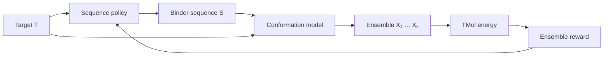

<p align="center">
  
</p>

<p align="center">
  <em>Ensemble-aware protein binder design with generative conformational models and differentiable molecular energetics.</em>
</p>

<p align="center">
  
  
  
</p>

## Overview

CINDER is a research framework for ensemble-aware protein binder sequence design with
differentiable molecular energetics. It is built to test one hypothesis: that ranking and
optimising binder sequences using an **ensemble** of conformations, scored by a differentiable
energy ([TMol](https://pypi.org/project/tmol/)), tracks binding better than scoring a single
minimised structure.



A sequence policy `q(S|T)` proposes binders; a conformation model `p(X|S,T)` draws K structures,
tilted toward low energy by a guidance strength λ; the energy `U(X,S,T)` is computed
deterministically; the average over the ensemble is the sequence's reward, and the policy is
updated by REINFORCE. The energy, the conformation model, the sequence optimiser and the
experiment machinery are separate components joined by typed interfaces, so they can be swapped
independently. Everything is config-driven (YAML), seeded and tested, and the toy CPU path always
runs without TMol.

**Status and honesty.** This is a research prototype. The energy tracks measured binding on three
SKEMPI complexes, but the ensemble has **not** been shown to beat a single packed structure, and no
design has been experimentally validated. Each ingredient, and several pairings, are established
prior art (see [Related work](#related-work)); the combination is a recombination of known parts,
not a demonstrated novelty. Measured results and open questions: [docs/results.md](docs/results.md)
and [TODO.md](TODO.md).

## Capabilities

| Area | What you can do | Needs TMol |
|---|---|---|
| Scoring | Score a complex (interface, repulsion, strain, `hbond`, `elec`, `internal`, soft H-bond graph first/second shell), with exact coordinate gradients | yes |
| Conformations | Langevin sampling with energy guidance in Cartesian, rigid-body (jump), torsion (phi/psi/chi) or combined spaces; ensembles around a packed mutant | yes (protein systems) |
| Learned models | Conditional normalising flow, diffusion and flow matching, trained and guided on toy coordinates | no |
| Mutation | Mutate binder residues and repack side chains (one packed pose per sequence, cached) | yes |
| Sequence design | REINFORCE with categorical or autoregressive (coupled) policies, design-space constraints, entropy bonus | toy: no; protein: yes |
| Exact-gradient design | Optimise expected energy on pairwise energy tables, plus baselines (best single, one-body, random search, greedy hill climb) | table build: yes |
| Position proposal | Pick design positions from H-bond shells or interface contacts | yes |
| Validation | Perturb-and-recover benchmarks, mutant and position scans, SKEMPI 2.0 comparison with measured ddG | yes |
| Outputs | Metrics and sequence CSVs, per-position probabilities, checkpoints, PDB files, `config.yaml` and `metadata.json` per run | no |

Not available yet: mutations in the target chain, BioEmu2 (stub), protein-scale learned models,
torsion degrees of freedom inside the design loop, and anything on GPU that has been tested.

## Install

```bash
conda activate cinder
pip install -e ".[dev,tmol]"   # drop ",tmol" for a CPU-only toy install
cinder doctor                   # reports the environment and optional backends
```

## Usage

### Command line

```bash
cinder design  --config configs/experiment/toy_design.yaml   # toy S→X→U→R→S loop, CPU, seconds
cinder design  --config configs/experiment/design_tmol.yaml  # barnase/barstar with TMol, minutes on CPU
cinder score   --config configs/experiment/score.yaml        # score the native complex (TMol)
cinder sample  --config configs/experiment/sample.yaml       # sample an ensemble, report energies
cinder analyze runs/<run_directory>                          # summarise a finished run
```

Every run writes `runs/<timestamp>_<name>/` with `config.yaml`, `metadata.json`, `metrics.csv`,
`sequences.csv`, `probabilities.csv` and checkpoints (benchmark scripts add `results.csv` and
`structures/`). `runs/` and `data/` are git-ignored.

### Configuration

An experiment is one YAML file with these sections (see `configs/` for complete examples):

| Section | Choose with | Examples |
|---|---|---|
| `system` | `kind` | toy, or `structure` with a PDB path, `target_chains`, `binder_chains`, `design_positions`, `forbidden_aa` |
| `energy` | `backend` | `toy_sequence`, `tmol` with per-term weights (`interface_weight`, `hbond_weight`, `elec_weight`, `hbond_graph_weight`, ...) |
| `conformation` | `backend` | `langevin` (toy), `rigid_langevin` (TMol; `n_samples`, `guidance_strength`, `step_size`, `n_steps`, `init_std`) |
| `sequence` | `backend` | `categorical`, `autoregressive`; `init: native` or `uniform` |
| `optimization` | `aggregator` | `batch_size`, `learning_rate`, `iterations`; aggregator `mean`, `median`, `softmin`, `quantile`, `free_energy` |

Setting `n_steps: 0, init_std: 0, n_samples: 1` reduces the ensemble to the single packed structure,
which is the baseline for the ensemble comparison. `device: auto` uses a GPU when present (the
default is CPU). Components and their interfaces are described in
[docs/architecture.md](docs/architecture.md).

### Scripts

Scripts download public PDB entries into `data/` on first use. Run them from the repository root.

| Script | Purpose |
|---|---|
| `scripts/structure_recovery.py` | displace the binder and test whether guided sampling recovers it (`--space {cartesian,rigid,torsion,torsion_rigid}`) |
| `scripts/mutant_scan.py` | score a CSV of mutants with the single structure and with the ensemble |
| `scripts/position_scan.py` | all 19 substitutions at interface positions, with the native residue's rank |
| `scripts/random_mutants.py` | low-rate, interface-biased random mutants |
| `scripts/mutate_refine.py` | noise the backbone, mutate, then refine by gradient descent |
| `scripts/table_design.py` | pairwise tables, exact-gradient design, and baselines (`--shells {first,second,both,contact}`) |
| `scripts/skempi_validation.py` | compare scores with measured SKEMPI 2.0 ddG (you supply `skempi_v2.csv`) |
| `scripts/validation_report.py` | reproduce the verification tables (about a minute on CPU) |

```bash
python scripts/structure_recovery.py --complex 2ZTA --space rigid --rot 0 2 --trans 0 1 --n 1 \
    --steps 4000 --step-size 2e-5 --lam0 5 --lam1 50 --clip 2000
python scripts/skempi_validation.py --skempi skempi_v2.csv --entry 3SGB_E_I --subsample 100
python scripts/table_design.py --complex 1CDL --shells contact
```

SKEMPI 2.0 is not shipped; download it and check its terms of use.

### As a library

```python
from cinder.config import config_from_dict
from cinder.experiments.runner import run_design

cfg = config_from_dict({"system": {"binder_length": 2}, "optimization": {"iterations": 120}})
result, run_dir = run_design(cfg)          # toy S→X→U→R→S loop
print(result.best_sequence, run_dir)
```

`config_from_dict` accepts the same nested keys as the YAML files; `build_components(cfg)` returns
the energy, conformation model, policy and design space for custom loops. Runnable examples are in
`examples/` (`01_score_complex.py`, `02_sample_langevin.py`, `03_optimize_sequence.py`).

### Tests and checks

```bash
pytest                 # CPU tests (155), TMol/GPU/slow tests excluded by default
pytest -m tmol         # TMol tests (52, about five minutes)
ruff check . && ruff format --check . && mypy src
```

## Repository structure

```
src/cinder/  types.py  config.py  cli.py  doctor.py
  systems/        design space, molecular system, rigid-body (jump) parametrization
  energy/         toy energies, composite, restraints, parametrized; tmol*.py (the only TMol imports)
  conformations/  Langevin, normalising flow, diffusion, flow matching (toy), guidance, BioEmu2 stub
  sequence/       categorical and autoregressive policies, design-space constraints
  objectives/     ensemble aggregators, H-bond graph, pairwise tables, regularisers
  optimization/   REINFORCE trainer, expected-energy optimiser, search baselines
  experiments/    runner, TMol reward and study, logging, checkpoints
  validation/     perturbations, recovery, mutation scans, SKEMPI, PDB fetch, checks
scripts/  configs/  docs/  examples/  tests/  assets/
```

## Related work

Prior art (not exhaustive):

- Ensemble-aware binder design: [ProChoreo](https://www.biorxiv.org/content/10.64898/2026.01.23.701298.full.pdf),
  [AlloGen](https://arxiv.org/html/2606.05474).
- Ensemble-averaged design with a Rosetta-family energy: [RosettaBackrub](https://pubmed.ncbi.nlm.nih.gov/21789164/),
  [flexible-backbone benchmark on binding interactions](https://pmc.ncbi.nlm.nih.gov/articles/PMC6901717/),
  [Rosetta:MSF multistate design](https://journals.plos.org/ploscompbiol/article?id=10.1371%2Fjournal.pcbi.1005600).
- Energy-guided sequence design for complexes: [EnerBridge-DPO](https://arxiv.org/pdf/2506.09496).
- Reinforcement learning for binders: [ProtRL](https://arxiv.org/pdf/2412.12979),
  [HighPlay](https://www.biorxiv.org/content/10.1101/2025.03.17.643626.full.pdf).
- Boltzmann-style ensemble objectives for conformation generators:
  [energy-based alignment](https://arxiv.org/pdf/2505.24203).
- Gradient-based sequence design over simulated ensembles (disordered proteins):
  [Nature Comput. Sci. 2025](https://www.nature.com/articles/s43588-025-00881-y).
- Energy/force-guided conformation sampling: [ConfDiff](https://arxiv.org/html/2403.14088v2),
  [energy-based diffusion Boltzmann generators](https://arxiv.org/abs/2401.02080).
- Single-structure backpropagation objectives (BindCraft-style), reviewed in
  [AI-driven binder design](https://spj.science.org/doi/10.34133/csbj.0070).
- TMol itself: [IPD Rosetta reimplementation](https://pypi.org/project/tmol/).

Not yet checked (those searches failed): differentiable-physics design through ensembles, and
BioEmu-based design. A full literature review is required before any publication claim.

## Documentation

[Results](docs/results.md) · [Theory](docs/theory.md) · [Architecture](docs/architecture.md) ·
[TMol](docs/tmol.md) · [Models](docs/models.md) · [Sequence optimisation](docs/sequence_optimization.md) ·
[H-bond graph](docs/hbond_graph.md) · [Validation](docs/validation.md) ·
[Development](docs/development.md) · [TODO](TODO.md)

## Citation

See [CITATION.cff](CITATION.cff). Test and benchmark structures are public RCSB PDB entries:
barnase/barstar (1BRS; Buckle, Schreiber & Fersht, 1994), committed as a fixture, and 2ZTA, 1CDL and
1G5J, downloaded at run time. Teddymer (CC BY-NC 4.0) was considered and not used; see
[docs/validation.md](docs/validation.md).

## License

Apache-2.0.
